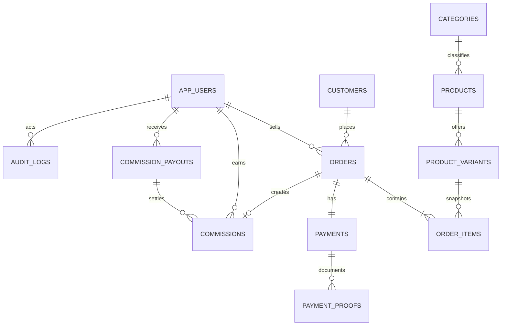

# Modelo de datos

## Decisiones clave

- UUID internos y código público aleatorio independiente. El código permite reclamar, no autenticar ni consultar libremente.
- `orders.idempotency_key` es único para hacer segura la repetición del checkout.
- `order_items` conserva nombres, SKU, precio, porcentaje y comisión históricos.
- Una comisión nace al asignar vendedor, queda `PENDING` y se aprueba al confirmar la venta.
- `commissions.payout_id` nullable permite agrupar comisiones en una liquidación y su asignación única impide doble pago.
- Los importes usan `NUMERIC(12,2)`. Cada comisión de línea se redondea a centavos con `ROUND_HALF_UP`; el total es la suma de líneas redondeadas.
- Los reportes usan intervalos semiabiertos `[inicio, fin)` en UTC, calculados desde límites civiles de `America/Guatemala`.
- Las referencias históricas usan `ON DELETE RESTRICT` o `SET NULL`; productos y usuarios se desactivan.

## Relación con Supabase Auth

`app_users.auth_user_id` referencia `auth.users(id)` mediante SQL nativo. Prisma no administra el esquema `auth`; así se evita que una migración accidental modifique tablas internas de Supabase. No se almacenan contraseñas.
