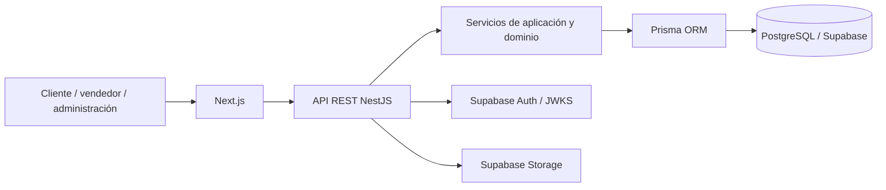

# Arquitectura del MVP

El sistema es un monolito modular. Es más rápido de entregar y mantiene transacciones ACID dentro de una sola base. Los módulos futuros son `auth`, `users`, `catalog`, `orders`, `payments`, `commissions`, `reports`, `audit` y `storage`.

No se adopta un starter externo: el repositorio estaba vacío y los flujos financieros requieren restricciones explícitas. Importar un starter agregaría supuestos y dependencias que habría que auditar.

La preparación para una futura multiempresa consiste en límites modulares y claves internas UUID. No se agrega `tenant_id` todavía: hacerlo sin requisitos de aislamiento, facturación y aprovisionamiento sería complejidad prematura y una migración futura seguirá siendo viable.
